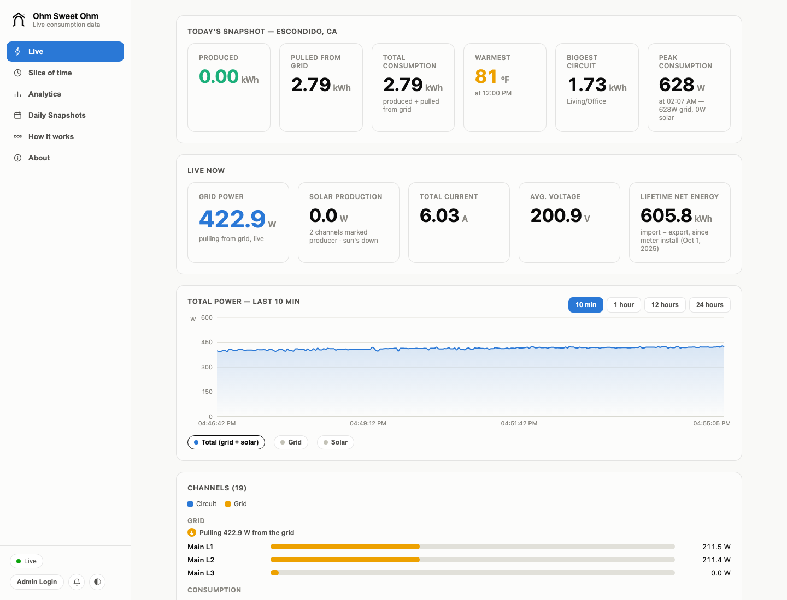
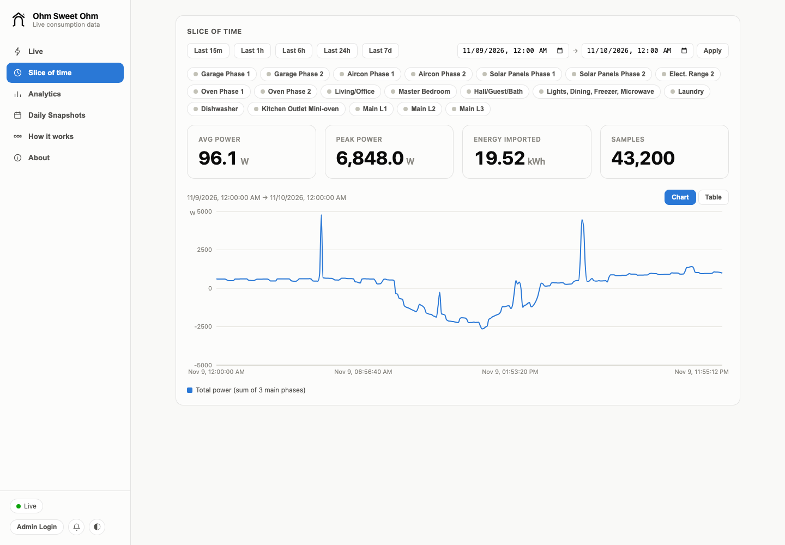
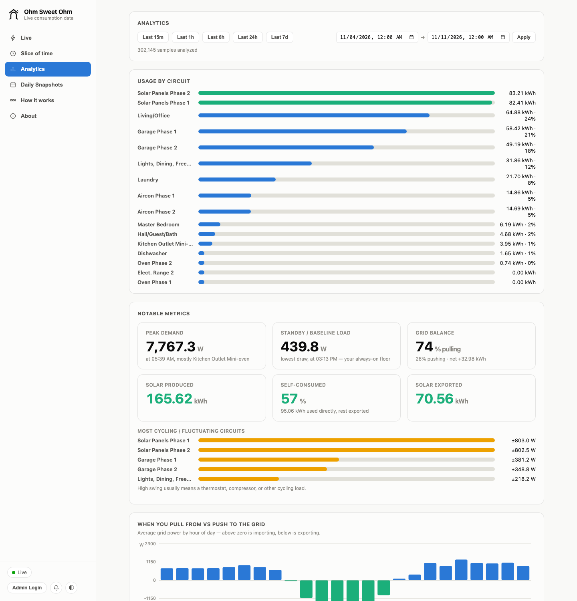
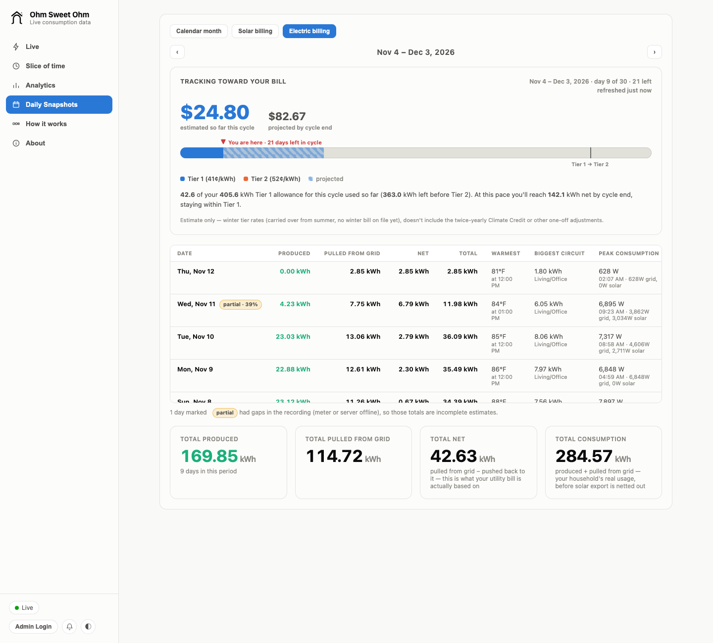
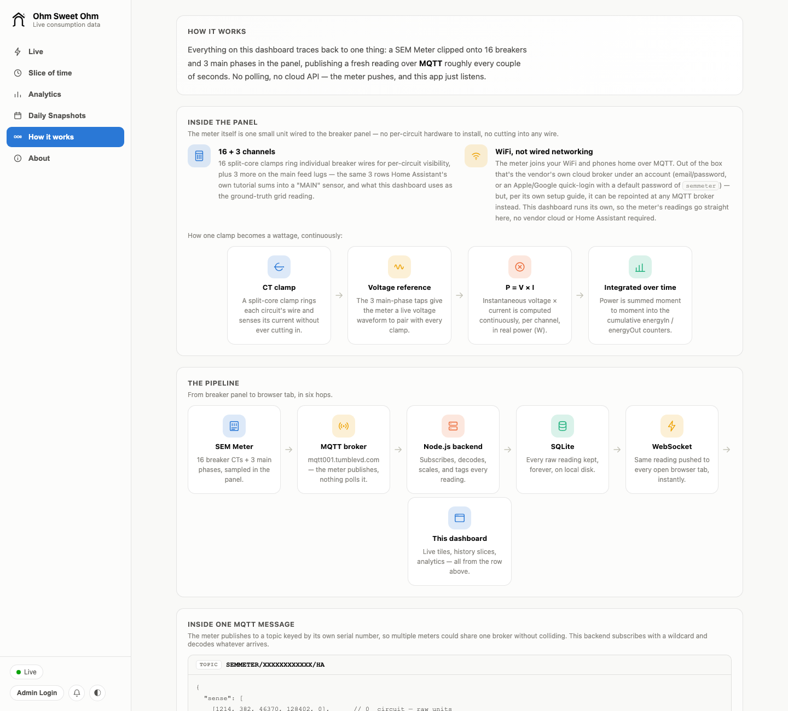
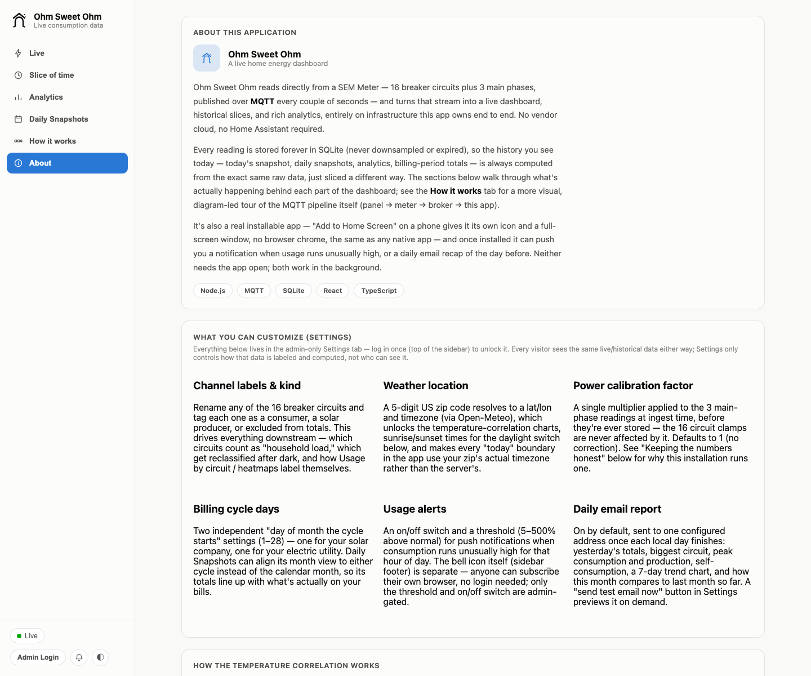
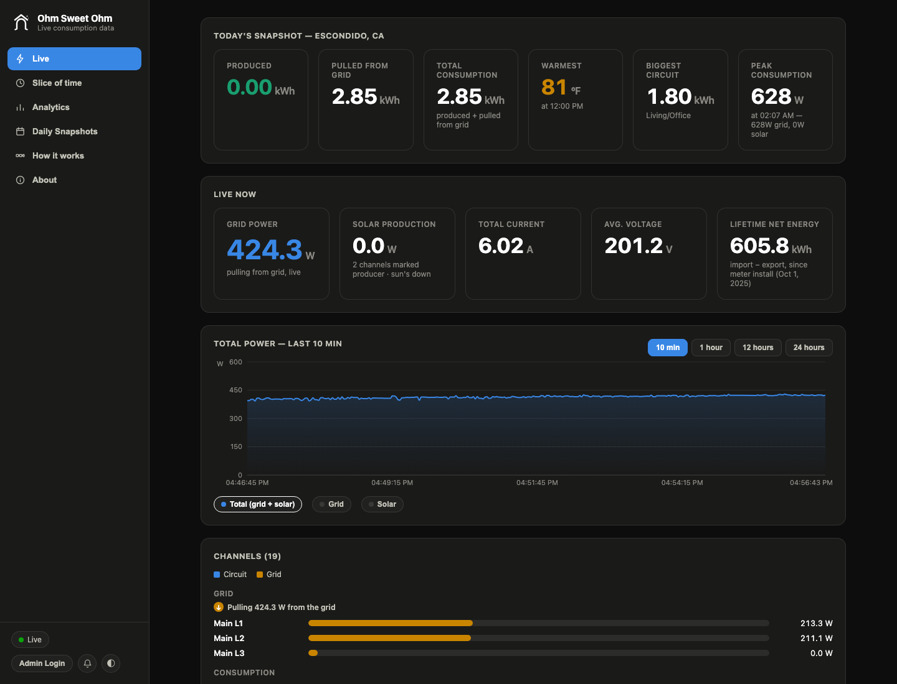

# Ohm Sweet Ohm

A live home energy dashboard for the **SEM Meter**: see what every circuit in your panel is drawing right now, how much your solar is producing, whether you're pulling from or pushing to the grid, and what it's all going to cost on your next utility bill.



## Highlights

- **Live view:** current grid power, solar production, voltage and current, plus a per-circuit breakdown that updates every couple of seconds.
- **Every circuit, named:** 16 breaker circuits and 3 main phases, each with your own label, marked as a consumer or a producer (e.g. solar).
- **Slice of time:** chart or tabulate any window, from the last 15 minutes to a custom range, and compare up to 3 circuits against the total.
- **Analytics:** usage by circuit, peak and standby load, when you import vs export, typical load by hour and day of week, and how consumption tracks outdoor temperature.
- **Daily snapshots and bill tracking:** one row per day, totals aligned to your real utility billing cycle, and a tier-aware cost estimate projected to the end of the cycle.
- **Usage alerts and a daily email:** a push notification when consumption runs well above normal for the hour, and a morning summary of yesterday.
- **Installable:** add it to your phone's home screen like an app. Light and dark themes.
- **Calibrated against the utility:** validated interval by interval against the utility's own 15-minute meter data and the solar installer's production export (details in [docs/TECHNICAL.md](docs/TECHNICAL.md)).

## Tour

### Live

Today's snapshot (produced, pulled from the grid, total consumption, warmest temperature, biggest circuit, peak load), the live readings, a rolling power chart (10 minutes to 24 hours) and every channel as a bar. Click any circuit to open its own live view.


### Slice of time

Pick a preset window (15 minutes to 7 days) or a custom start and end, then switch between a chart and a table. Average power, peak power, energy imported and the sample count are summarized at the top. Click circuit chips to overlay up to 3 circuits on the total.



### Analytics

Pick a range and get: usage by circuit (kWh and share of total), notable metrics (peak demand, standby load, most-cycling circuits, solar self-consumption), when you typically pull from vs push to the grid, the most-consuming circuits by hour of day, typical load by day of week, grid exchange by week, and consumption vs outdoor temperature.



### Daily Snapshots

One row per day with produced, pulled from grid, net, total, warmest temperature, biggest circuit and peak consumption. Switch between the calendar month, your solar billing cycle and your electric billing cycle, and step back and forth between periods. In electric billing mode, a gauge tracks the cycle's cost so far and its projected total against your utility's tiers.



### How it works

A visual walkthrough of the data path: the clamps in the panel, the MQTT message the meter publishes, and how it turns into the numbers on screen.



### About

What the app does, what you can customize, how the temperature correlation and the daylight switch work, and how the numbers are kept honest.



### Dark mode



### Settings (admin only)

Everything above is public; **Settings** appears only after signing in with **Admin Login** at the bottom of the sidebar. It holds:

- **Configure channels:** rename each of the 19 channels, mark circuits as consumers or producers, and set a per-circuit calibration factor.
- **Weather:** the zip code used for weather correlation and the local time zone.
- **Billing periods:** the day each solar billing cycle starts, and your utility's meter-read dates for the electric cycle.
- **Power calibration:** the mains calibration factor and the import correction.
- **Usage alerts:** turn alerts on and set how far above normal triggers one.
- **Daily email report:** turn it on and set the address it goes to.
- **Alexa Routine trigger:** link the optional Alexa skill (see [alexa-skill/README.md](alexa-skill/README.md)).

## Requirements

- A **SEM Meter** installed in your panel, set up in the SEM app, with its MQTT integration enabled (see the vendor's [MQTT / Home Assistant tutorial](https://vs.tumblevd.com/SEM/homeasistant.html)).
- Your SEM app login and the meter's **serial number**.
- **Node.js 22.5 or newer** (the server uses Node's built-in SQLite).
- Optional: **Python 3** with `paho-mqtt`, only for the connection check script.

## Setup

### 1. Clone and install

```bash
git clone https://github.com/langecornu/Ohm-Sweet-Ohm.git
cd Ohm-Sweet-Ohm
cd server && npm install && cd ..
cd web && npm install && cd ..
```

### 2. Add your meter credentials

Create a file named `.env` in the repo root (it's git-ignored):

```bash
SEMMETER_USER=you@example.com         # your SEM app login
SEMMETER_PASS=your-sem-app-password
DEVICE_SN=YOUR_DEVICE_SERIAL          # the meter's serial number
ADMIN_EMAIL=you@example.com           # the admin account created on first start
```

Optional extras, each of which the app runs fine without:

| Variables | Turns on |
|---|---|
| `VAPID_PUBLIC_KEY`, `VAPID_PRIVATE_KEY`, `VAPID_SUBJECT` | Push notifications for usage alerts |
| `SMTP_HOST`, `SMTP_PORT`, `SMTP_TOKEN`, `MAIL_FROM` | Password-reset and daily-report emails |

[deploy/env.example](deploy/env.example) documents every variable, including how to generate the push notification keys.

### 3. Check the meter is publishing (optional)

```bash
python3 -m pip install paho-mqtt
python3 validate_semmeter_mqtt.py --sn YOUR_DEVICE_SERIAL
```

It reads your login from the environment (or prompts for it) and reports whether a reading arrives within the timeout. If nothing arrives, the meter is offline or its MQTT integration isn't enabled.

### 4. Run it

In two terminals:

```bash
cd server && npm start
```

```bash
cd web && npm run dev
```

Open the address Vite prints (usually http://localhost:5173). The dev server forwards `/api` and `/ws` to the backend on port 8787. Readings start arriving within a few seconds; history builds up from the moment the server first connects.

For a single-process setup, run `npm run build` in `web/`. The server then serves `web/dist` itself on port 8787.

### 5. Sign in and configure

1. On first start the server creates the admin account for `ADMIN_EMAIL` and prints a one-time password in its log. Copy it.
2. Click **Admin Login** at the bottom of the sidebar and sign in. **Settings** appears in the sidebar.
3. Open **Settings → Configure channels**. Give each circuit a real name (Kitchen, Air conditioner, …) and mark your solar circuits as **producers**.
4. Under **Weather**, enter your zip code. This sets the local time zone used for day boundaries and turns on the temperature charts.
5. Under **Billing periods**, enter your utility's meter-read dates (on each bill: the end of the billing period and the "next scheduled read date") so totals and cost tracking line up with your real bill.
6. Optionally turn on **Usage alerts** (then tap the bell icon in the sidebar on each device that should get them) and the **Daily email report**.

Use **Forgot password** on the login form to reset the admin password. The reset link is emailed if email is configured, and always printed in the server log.

## Using the dashboard

- **Is the house pulling from or pushing to the grid?** On **Live**, the grid power card says *pulling from grid* or *pushing to grid*, and the Grid section of the channel list shows the direction.
- **What's using power right now?** On **Live**, the channel bars are sorted by draw. Click a circuit to see its own live chart.
- **What happened last night?** Open **Slice of time**, choose *Last 24h* or a custom range, and click circuit chips to compare them with the total. Switch to **Table** for exact values.
- **Which circuits cost the most?** Open **Analytics**, pick a range, and read *Usage by circuit* and *Most-consuming circuits by hour of day*.
- **Does heat drive my usage?** Open **Analytics** and scroll to *Consumption vs outdoor temperature*.
- **Am I on track for my bill?** Open **Daily Snapshots** in **Electric billing** mode. The gauge shows the cost so far and the projected total for the cycle. Use the arrows to step through past cycles and compare them with your actual bills.
- **Install it on your phone:** open the site in your phone's browser and choose *Add to Home Screen*.
- **Switch theme:** use the half-circle button at the bottom of the sidebar.

## Calibration

Out of the box, every reading is shown as the meter reports it. If your totals don't match your utility bill, compare a few days against your utility's interval data and adjust **Settings → Power calibration** and the per-circuit factors. [docs/TECHNICAL.md](docs/TECHNICAL.md) walks through how this installation was calibrated, including the scripts that rewrite stored history after a change.

## Deployment

The production instance runs on a small Linux VM behind nginx, as a systemd service. See [docs/TECHNICAL.md](docs/TECHNICAL.md#production-deployment) and the files in [deploy/](deploy/).

## Project layout

```
server/         Node.js backend: MQTT ingest, SQLite history, REST API and WebSocket
  src/          application code
  scripts/      one-off maintenance scripts (history rescales, aggregate backfill)
web/            React + Vite dashboard
alexa-skill/    optional Alexa Smart Home skill (AWS Lambda)
deploy/         systemd unit, nginx config, environment template
docs/           screenshots and technical notes
validate_semmeter_mqtt.py   standalone MQTT connection check
```

## Credits

Built with these open source projects:

**Server**

- [Express](https://expressjs.com/) (MIT): HTTP server and REST API
- [ws](https://github.com/websockets/ws) (MIT): WebSocket server for live readings
- [MQTT.js](https://github.com/mqttjs/MQTT.js) (MIT): MQTT client for the meter feed
- [web-push](https://github.com/web-push-libs/web-push) (MPL-2.0): push notifications
- [Nodemailer](https://nodemailer.com/) (MIT-0): email delivery
- [dotenv](https://github.com/motdotla/dotenv) (BSD-2-Clause): environment configuration
- [cors](https://github.com/expressjs/cors) (MIT): CORS middleware
- [Node.js](https://nodejs.org/) and its built-in SQLite module: history storage

**Web**

- [React](https://react.dev/) (MIT): user interface
- [Recharts](https://recharts.org/) (MIT): charts
- [Vite](https://vite.dev/) (MIT) and [@vitejs/plugin-react](https://github.com/vitejs/vite-plugin-react) (MIT): build tooling
- [TypeScript](https://www.typescriptlang.org/) (Apache-2.0): type checking
- [Oxlint](https://oxc.rs/) (MIT): linting

**Tools**

- [Eclipse Paho MQTT Python client](https://github.com/eclipse/paho.mqtt.python) (EPL-2.0 / EDL-1.0): used by the connection check script

**Data services**

- Weather data by [Open-Meteo.com](https://open-meteo.com/), licensed under [CC BY 4.0](https://creativecommons.org/licenses/by/4.0/)
- Zip code lookup by [Zippopotam.us](https://www.zippopotam.us/)

**Hardware**

- The SEM Meter and its MQTT integration are made by its manufacturer. Its MQTT setup is documented in the vendor's [Home Assistant tutorial](https://vs.tumblevd.com/SEM/homeasistant.html). This project isn't affiliated with or endorsed by the manufacturer.

## License

MIT. See [LICENSE](LICENSE).
